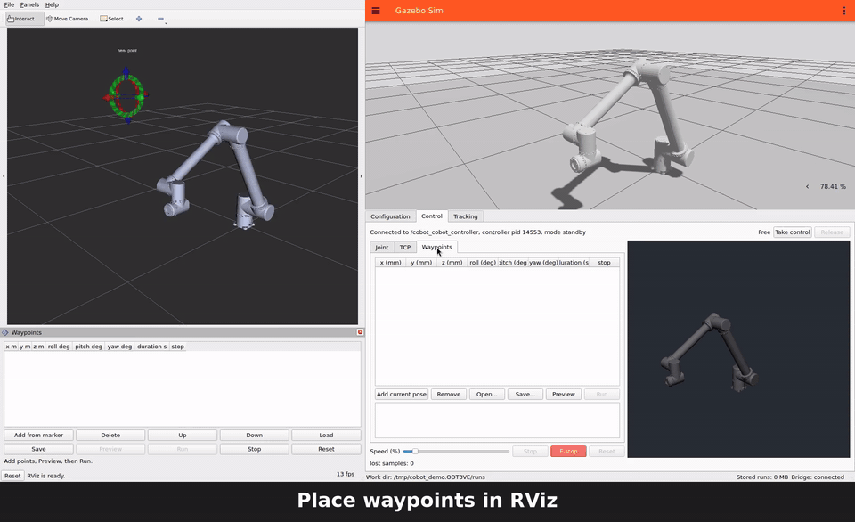
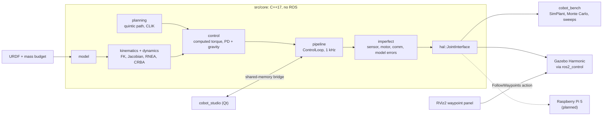
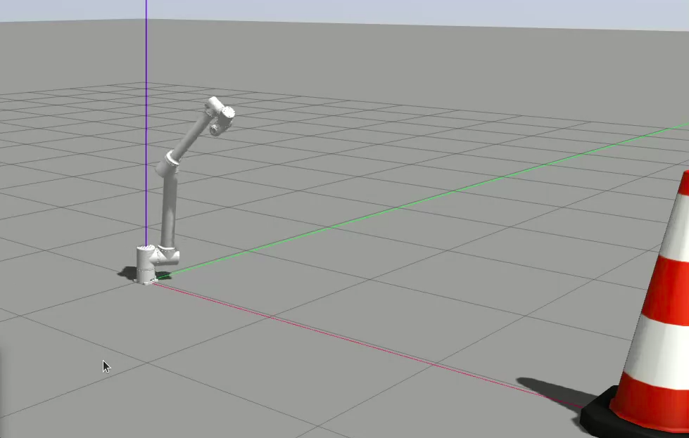

# Dynamics Modeling and Control of a 7-DOF Robotic Arm

A 7-DOF arm controller in C++17, from the URDF to the torque command: a dynamics library written
from scratch, a 1 kHz computed-torque loop, and a simulation that adds real-hardware errors and
tells you which hardware is good enough.

[](https://github.com/NguyenVu1010/Dynamics_Modeling_and_Control_of_7DOF_Robotic-Arm/actions/workflows/ci.yml)


[](LICENSE)

[](docs/media/demo-v1.mp4)
*Waypoints placed in the RViz2 panel and previewed, then run from `cobot_studio`: Gazebo, RViz and
the studio's 3D view follow the arm together under the 1 kHz computed-torque controller, and the
Tracking tab plots the run. [Full-resolution video](docs/media/demo-v1.mp4); recorded by
[`tools/demo/record_demo.sh`](tools/demo/record_demo.sh).*

## Highlights

- **Dynamics written from scratch.** FK, geometric Jacobian, RNEA, CRBA and forward dynamics
  without Pinocchio or KDL ([ADR-004](docs/adr/004-self-written-dynamics.md),
  [derivations](docs/derivations/)). They match KDL on 100 random 7-DOF states within a
  relative tolerance of 1e-6 ([test](tests/unit/dynamics/test_kdl_reference.cpp)) and
  closed-form pendulum and two-link models within 1e-12
  ([test](tests/unit/dynamics/test_analytic.cpp)).
- **Real-time 1 kHz loop.** One control step takes 5.3 µs at p95 on a desktop, about 0.5 % of the
  1 ms period ([PF-01](docs/results/realism/timing_desktop.txt)). A test counts every
  `operator new` and fails if `ControlLoop::step()` allocates
  ([test](tests/component/control_loop/test_control_loop_no_alloc.cpp)). Errors come back as
  `Status` values, and the tracking law is `noexcept`
  ([static_assert](tests/unit/control_registry/test_algorithms.cpp)).
- **Bit-reproducible runs.** Two runs with the same seed give byte-identical CSV logs. CI checks
  this on every PR (E2E-03, [test levels](docs/guides/testing.md#test-levels)).
- **Sim-to-real study, not only a simulation.** An imperfection layer adds encoder resolution,
  noise, delays, torque errors, friction, model mismatch, elastic gearboxes and packet loss
  ([ADR-015](docs/adr/015-imperfections-and-sim-to-real.md),
  [ADR-019](docs/adr/019-realism-2-hardware-profiles.md)). A sweep of 12 parameters gives a
  [hardware requirement table](docs/results/realism/hardware_requirements.md): sensor delay
  ≤ 4 cycles and torque-constant error ≤ 20 %. With realistic errors, 50 of 50 Monte Carlo seeds
  pass ([Monte Carlo](docs/results/realism/montecarlo.md)).
- **Hardware tiers compared.** Three profiles take the sensor, gearbox and communication
  quality of real arms (Franka FR3, Kassow KR1205, xArm 7). On premium and mid, the final
  position error stays at least 8x under the threshold. On budget (250 Hz servo), torque sent
  from the host trips the safety hold on every seed
  ([E2E-12](tests/e2e/scenarios/e2e_12_profiles.yaml)). A position loop in the simulated drive
  removes the holds, but the final position error still reaches 7.5 mm on the worst seed
  ([E2E-14](tests/e2e/scenarios/e2e_14_budget_drive.yaml)).
- **Hardware verification with a stated confidence.** `cobot_bench verify` and the studio's
  Verification tab tune the law's gain per hardware model, run 100 Monte Carlo seeds and give a
  three-level verdict from a 95 % Wilson interval, with the assumptions that could change it, the
  main cause of a failure and a suggestion
  ([ADR-023](docs/adr/023-hardware-scenario-verification.md),
  [results](docs/results/verify/README.md)). Premium and mid pass (100/100). Budget with torque
  from the host fails at every gain (0/100); the report names the 250 Hz link as the main cause
  and suggests a position loop in the drive. With that loop, budget is marginal (92/100, Wilson
  0.85..0.96). Seeds 101..200 give the same four verdicts.
- **The same controller in two hosts.** It runs in Gazebo Harmonic through `ros2_control` and in
  a ROS-free bench. Gazebo with realistic errors ends 0.071 mm from the goal
  ([E2E-09](docs/results/realism/e2e_09/report.md)). An RViz2 waypoint panel and the Qt app
  `cobot_studio` drive it. If the app freezes, the arm reaches standby at most 0.709 s after its
  last heartbeat (bound: 0.705 s plus 5 ms observer resolution, [stop guarantee](docs/results/studio/README.md#stop-guarantee)).
- **Engineering process.** Tests are written first and frozen on `main`
  ([check](tools/ci/check_frozen_tests.sh)). 8 required CI jobs run on every PR: lint, frozen
  tests, build and test, ASan + UBSan, line coverage ≥ 80 % on `src/core`, Python, bench E2E and
  Gazebo E2E ([ci.yml](.github/workflows/ci.yml)). An arm64 Raspberry Pi 5 image builds and tests
  nightly ([arm64.yml](.github/workflows/arm64.yml)). Design decisions are recorded in [23 ADRs](docs/adr/).

## Architecture



| Directory | Content |
| --- | --- |
| `src/core/` | the controller library: model, kinematics, dynamics, planning, control, HAL, imperfections, pipeline, bridge |
| `src/bench/` | `cobot_bench`: ROS-free host for runs, Monte Carlo, sweeps, timing and `serve` |
| `src/ros2_node/` | `ros2_control` controller plugin around `ControlLoop` |
| `src/ros2_gui/`, `src/ros2_interfaces/` | RViz2 waypoint panel, `FollowWaypoints` action |
| `src/studio/` | `cobot_studio`: configuration, live control, tracking plots, 3D replay |
| `src/sim/` | URDF/xacro, meshes, Gazebo world and launch files |
| `src/eval/` | Python reports and sensitivity analysis (reads CSV only) |
| `config/` | controller configs and imperfection profiles (YAML) |
| `tests/`, `tools/`, `docker/` | unit, component and E2E tests; WSL and CI scripts; Pi 5 and ROS images |

More detail, including one control cycle step by step: [architecture](docs/guides/architecture.md).

## Results

Thresholds and full numbers: [tests and results](docs/guides/testing.md#results).

| Check | Threshold | Measured |
| --- | --- | --- |
| E2E-02 bench, realistic sensors, motors and friction | 5 mm / 2° / 0.02 rad | 0.060 mm / 0.0075° / 1.8e-4 rad ([report](docs/results/realism/e2e_02/report.md)) |
| E2E-05 Monte Carlo, 50 seeds, realistic | ≥ 95 % pass | 100 % ([table](docs/results/realism/montecarlo.md)) |
| E2E-09 Gazebo, realistic profile | 5 mm / 2° / 0.02 rad | 0.071 mm / 0.014° / 2.3e-4 rad ([report](docs/results/realism/e2e_09/report.md)) |
| E2E-11 Gazebo, waypoints through the action | 5 mm / 2° / 0.02 rad | 0.055 mm / 0.013° / 2.0e-4 rad ([report](docs/results/waypoints/e2e_11/report.md)) |
| PF-01 control step, desktop | p95 < 200 µs | p50 4.8 µs, p95 5.3 µs ([timing](docs/results/realism/timing_desktop.txt)) |
| PF-02 studio bridge cost per step | – | +0.17 µs at p50 ([studio](docs/results/studio/README.md#pf-02-control-step-with-the-studio-bridge)) |
| Stop guarantee, frozen studio | 0.705 s + 5 ms observer poll | 0.709 s max over 5 trials ([studio](docs/results/studio/README.md#stop-guarantee)) |
| E2E-08 arm64 Pi 5 image (QEMU), nightly | ctest + E2E-01..04 | pass in CI |
| E2E-16 verify, 3 models, 100 seeds, nightly | PASS: Wilson lower bound ≥ 95 % and worst ≤ 80 % of each threshold | premium PASS, mid PASS, budget FAIL, budget + drive loop MARGINAL ([results](docs/results/verify/README.md)) |
| E2E-17 same, seeds 101..200, nightly | same verdicts | same verdicts ([comparison](docs/results/verify/e2e_17/comparison.md)) |

## Quick start

Everything runs in WSL Ubuntu 24.04 with ROS 2 Jazzy and Gazebo Harmonic; details in
[build and run](docs/guides/build.md).

```bash
tools/wsl/setup.sh                  # prints the apt line to run, creates the Python venv
tools/wsl/build.sh --studio         # CMake + Ninja, -Werror, all C++ tests (ctest)
tools/wsl/pytest.sh                 # Python tests

# Bench E2E scenarios (E2E-01..04, 10, PF-01)
B=~/projects/7dof_dynamic_control/build/main
~/projects/7dof_dynamic_control/venv/bin/python tools/run_e2e.py --all --tag pr \
  --bench $B/src/bench/cobot_bench --out out/pr

# Hardware verification: tune, 100 runs, verdict and report (several models in one call)
$B/src/bench/cobot_bench verify --hardware config/hardware/premium_fr3.yaml   --algorithm computed_torque --task config/tasks/reference_move.yaml --out out/verify

# Gazebo with the real controller, then the studio connected to it
tools/wsl/sim.sh build && source tools/wsl/env.sh
ros2 launch cobot_sim sim.launch.py controller:=cobot_controller studio:=true gui:=true
~/projects/7dof_dynamic_control/build/main/src/studio/app/cobot_studio   # second terminal
```

On another branch, replace `build/main` with `build/<branch>` (`/` becomes `-`).

### Waypoint GUI

The RViz2 panel adds waypoints from a draggable marker, previews the path without moving, runs
it, and can stop and reset the arm:

```bash
ros2 launch cobot_sim sim.launch.py controller:=cobot_controller rviz:=true
```

Full workflow: [waypoint GUI guide](docs/guides/waypoint-gui.md).



## Documentation

| Topic | Where |
| --- | --- |
| Build, run, Gazebo, logs, external command mode | [docs/guides/build.md](docs/guides/build.md) |
| RViz2 waypoint panel and headless bridge client | [docs/guides/waypoint-gui.md](docs/guides/waypoint-gui.md) |
| `cobot_studio` and manual control, safety rules | [docs/guides/studio.md](docs/guides/studio.md) |
| Controller and environment YAML, imperfection profiles | [docs/guides/configuration.md](docs/guides/configuration.md) |
| Test levels and full results | [docs/guides/testing.md](docs/guides/testing.md) |
| Hardware verification: models, tasks, reports, results | [docs/guides/verification.md](docs/guides/verification.md), [docs/results/verify](docs/results/verify/README.md) |
| Layout, control data flow, project phases | [docs/guides/architecture.md](docs/guides/architecture.md) |
| Frames, units, data contracts | [docs/conventions.md](docs/conventions.md) |
| Architecture decisions (Vietnamese) | [docs/adr/](docs/adr/) |
| Derivations: Jacobian, RNEA, CRBA, control | [docs/derivations/](docs/derivations/) |
| Design documents (Vietnamese) | [docs/design/](docs/design/) |
| Lessons learned (Vietnamese) | [docs/lessons/](docs/lessons/README.md) |
| Rules for every change | [CONTRIBUTING.md](CONTRIBUTING.md) |

The previous ROS 1 / Python implementation (six nodes, Maple closed-form M, C, G) is kept at
tag [`v0-python`](https://github.com/NguyenVu1010/Dynamics_Modeling_and_Control_of_7DOF_Robotic-Arm/tree/v0-python).

## Tóm tắt

Đồ án tốt nghiệp: lõi động lực học C++17 tự viết (FK, Jacobian, RNEA, CRBA, không dùng
Pinocchio hay KDL) và bộ điều khiển computed torque 1 kHz cho tay máy 7 bậc, mô hình đọc từ một
file URDF. Cùng bộ điều khiển chạy trong Gazebo Harmonic qua `ros2_control` và trong bench không
ROS. Lớp mô hình không hoàn hảo (nhiễu, trễ, sai số động cơ, ma sát, hộp số đàn hồi, mất gói)
cùng ba profile phần cứng cho biết phần cứng nào đủ dùng. Lệnh `cobot_bench verify` và tab Kiểm
nghiệm của `cobot_studio` tự chỉnh hệ số, chạy 100 lần Monte Carlo và kết luận ĐẠT, KHÔNG ĐẠT hay
SÁT NGƯỠNG kèm khoảng tin cậy và các giả định. `cobot_studio` cũng điều khiển tay máy bằng tay và
vẽ sai số bám. Đích phần cứng sau này là Raspberry Pi 5. ADR, thiết kế và bài học viết
bằng tiếng Việt trong `docs/`.

## License

MIT, see [LICENSE](LICENSE). The `cobot_studio` binary links Qt Charts (GPLv3), so that binary
as distributed is under GPLv3 ([studio guide](docs/guides/studio.md)).
