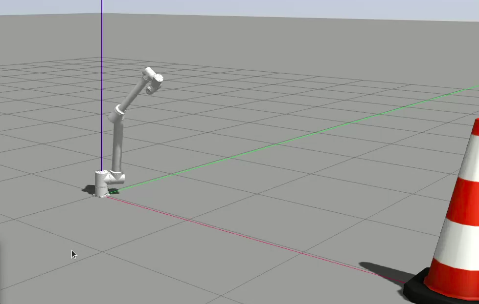

# Dynamics Modeling and Control of a 7-DOF Robotic Arm


A final-year project: a self-written C++17 dynamics core (forward kinematics, geometric
Jacobian, RNEA, CRBA, forward dynamics, no Pinocchio or KDL) and a 1 kHz computed-torque
controller for a 7-DOF arm, read from a single URDF. The controller runs in Gazebo Harmonic
through `ros2_control` and in a ROS-free bench, a configurable imperfection layer (encoder
resolution, noise, delays, torque errors, friction, model mismatch) turns the simulation into a
sim-to-real sensitivity study, and the core is kept free of anything a Raspberry Pi 5 cannot
install with `apt`, which is the later hardware target.



## Layout

```
core/         C++17, no ROS; one target cobot::<module> per directory
  common/       VecN, MatN, Pose, Timestamp, Result, logger, so3_exp/so3_log
  model/        URDF -> Model<N> (fixed joints merged)
  kinematics/   FK, Jacobian J_e_b, Jdot*qdot
  dynamics/     RNEA, CRBA, G, C*qdot, forward dynamics, SimPlant
  planning/     quintic Cartesian trajectory, CLIK reference
  control/      computed torque, hold mode
  hal/          JointInterface<N>
  imperfect/    sensor/actuator/model imperfections
  pipeline/     ControlLoop, YAML config, SPSC ring, CSV
ros2_node/    ros2_control controller plugin around ControlLoop
bench/        cobot_bench: ControlLoop + SimPlant, run / montecarlo / sweep / timing
sim/          cobot_sim: URDF/xacro, meshes, world, controllers, launch
eval/         Python reports and sensitivity analysis (reads CSV only)
config/       default.yaml, imperfections/, sweeps/
docker/       Pi 5 (arm64) and ROS 2 + Gazebo images
tests/        unit/, component/, e2e/scenarios/, python/, data/
tools/        wsl/ scripts, ci/ checks, URDF mass fix, E2E runner
```

## Control data flow

One 1 kHz cycle (`ControlLoop::step()`), two tiers:

```
                     reference tier (planning)                 control tier (control)
                  +------------------------------+          +--------------------------+
 goal pose ---->  | CartesianTrajectory (quintic)|  x_d     | ComputedTorque           |
 (YAML)           |  x_d, xd_d, xdd_d            | -------> |  tau = M(q)(qdd_d        |
                  | ClikReference (2nd order,    |  q_d,    |   + Kd(qd_d - qd)        |
                  |  DLS, joint-limit null space)|  qd_d,   |   + Kp(q_d - q))         |
                  |  runs on q_d, not on q       |  qdd_d   |   + C qd + G + D qd      |
                  +------------------------------+ -------> |  clamp tau_max; hold mode|
                                                            +------------+-------------+
                                                                 tau     |   ^ q, qd
                                                                         v   |
                              +------------------------------------------------------+
                              | ImperfectJointInterface<N>  (decorator, optional)     |
                              |   read: quantise, noise, offset, delay               |
                              |   write: torque scale, ripple, resolution, lag, delay|
                              +------------------------------------------------------+
                              | hal::JointInterface<N>                               |
                              |   SimJointInterface (SimPlant)  |  gz_ros2_control   |
                              +------------------------------------------------------+
```

The core creates no threads; the host (`cobot_bench` or `controller_manager`) owns the control
thread and drains the log ring into a CSV file.

## Status

| Phase | Content | Status |
| --- | --- | --- |
| 0 | Repo setup: build, CI jobs, corrected URDF, Gazebo assets, interface headers, docs, ADRs | done (#1, #5) |
| 1 | `common-lie`, `model-urdf`, `pipeline-config`, `eval-report` | done (#2, #3, #4, #7) |
| 2 | `kinematics`, `planning-traj`, `imperfect-io` | done (#6, #8, #9) |
| 3 | `dynamics` (with KDL reference fixture), `planning-clik` | done (#10, #11) |
| 4 | `sim-plant`, `control` | done (#12, #13) |
| 5 | `control-loop`, `bench-e2e` | done (#14, #15) |
| 6 | `ros2-controller` (Gazebo), `sensitivity` | done (#16, #17) |
| 7 | `mvp-results`: tuning, reports, hardware requirement table | done |
| 8 | Realism: friction compensation, armature, stick-slip plant friction, Gazebo with noise | done (#23–#28) |

MVP acceptance (G3): track a fixed 10 s straight-line trajectory; at t = 12 s end-effector
position error < 2 mm, orientation error < 1°, joint tracking RMS < 0.01 rad, desktop step
time p95 < 200 µs.

### Results

Current report: [docs/results/realism](docs/results/realism/README.md). The MVP baseline stays in
[docs/results/mvp](docs/results/mvp/README.md) for comparison.

| Check | Threshold | MVP | Current |
| --- | --- | --- | --- |
| E2E-01 bench, ideal | 2 mm / 1° / 0.01 rad | 2.6e-7 mm / 9.8e-7 rad | 6.7e-8 mm / 6.7e-7 rad |
| E2E-02 bench, realistic sensors, motors and friction | 5 mm / 2° / 0.02 rad | 0.17 mm / 0.31° / 0.0105 rad | 0.060 mm / 0.0075° / 1.8e-4 rad |
| E2E-05 Monte Carlo, 50 seeds realistic | ≥ 95 % pass | 96 % | 100 % |
| E2E-07 Gazebo Harmonic, ideal | 2 mm / 1° / 0.01 rad | 0.000 mm / 3.7e-6 rad | 0.000 mm / 4.8e-6 rad |
| E2E-09 Gazebo, realistic profile | 5 mm / 2° / 0.02 rad | – | 0.071 mm / 0.014° / 2.3e-4 rad |
| PF-01 control step, desktop | p95 < 200 µs | p95 4.9 µs | p95 5.3 µs |
| E2E-08 arm64 Pi5-like image (QEMU) | ctest + E2E-01..04 | pass in CI | pass in CI |

The main gain came from modelling the gearbox-reflected rotor inertia (armature, `J_in N²`):
without it the wrist inertia was about 1300× too small and its effective stiffness
`M_ii k_p` about 1 N·m/rad. The MVP friction numbers were also optimistic, because the old plant
lost Coulomb friction numerically. Armature values are assumed until the eRob H-series datasheet
is confirmed (`sim/urdf/mass_budget.yaml`).

The sweep over 12 sensor, motor, model and timing parameters gives a
[hardware requirement table](docs/results/realism/hardware_requirements.md): sensor delay
≤ 4 cycles and torque constant error ≤ 20 % are the binding limits. Peak torque now reaches
89 % of `τ_max` in Monte Carlo, so faster trajectories need a torque check.

Environment parameters are edited in config files, not code: `config/imperfections/*.yaml`
(sensor, motor, friction, model mismatch, timing, seed), `config/default.yaml` (gains, friction
compensation) and `sim/urdf/mass_budget.yaml` (masses, armature). Gazebo takes the profile with
`imperfections_path:=` and `seed:=`.

## Build

All C++ builds run in WSL Ubuntu-24.04 (ROS 2 Jazzy and Gazebo Harmonic installed). From
PowerShell: `wsl -d Ubuntu-24.04 -- bash <repo>/tools/wsl/<script>.sh`.

Everything the scripts generate lives in one folder per project, `~/projects/7dof_dynamic_control/`
(override with `COBOT_ROOT`): `build/<branch>[-asan|-cov]`, `colcon/<branch>`, `venv`, `out`.
`tools/wsl/prune.sh` removes the builds of branches that no longer exist.

```bash
tools/wsl/setup.sh                 # prints the apt line to type, creates the venv
tools/wsl/build.sh                 # CMake + Ninja, -Werror, ctest
tools/wsl/build.sh --asan          # Debug with ASan + UBSan
tools/wsl/build.sh --target T      # one target
tools/wsl/pytest.sh                # Python tests
tools/wsl/lint.sh                  # clang-format, clang-tidy, ruff
tools/wsl/sim.sh build             # colcon build of sim/ and ros2_node/ (cobot_ros2)
tools/wsl/sim.sh check             # xacro + check_urdf + gz sdf, no Gazebo needed
tools/wsl/sim.sh smoke             # headless Gazebo, 20 s
source tools/wsl/env.sh            # ROS 2 + workspace, own ROS domain (42) and Gazebo partition
```

`env.sh` keeps this project apart from other ROS 2 projects in the same WSL, which use the
default domain 0: override with `COBOT_ROS_DOMAIN_ID` / `COBOT_GZ_PARTITION`. `sim.sh build`
wipes the colcon workspace when it was built from another source directory (a deleted worktree).

The real controller in Gazebo (after `sim.sh build` and `source tools/wsl/env.sh`):

```bash
ros2 launch cobot_sim sim.launch.py controller:=cobot_controller [gui:=true]   [config_path:=config/default.yaml] [imperfections_path:=config/imperfections/realistic.yaml]   [seed:=7] [log_path:=results/<run-id>/run.csv]
python tools/run_e2e.py --all --tag gazebo --out results/e2e-gazebo   # E2E-07, E2E-09
```

## Environment configuration

Two kinds of YAML file, kept apart:

| File | Holds |
| --- | --- |
| `config/default.yaml` | the controller: URDF path, rate, trajectory, CLIK, computed-torque gains, friction compensation, safety |
| `config/imperfections/*.yaml` | the environment (the robot as it really is): sensors, motors, friction, model mismatch, timing, seed |

Profiles: `ideal.yaml` (perfect robot), `realistic.yaml` (typical industrial servo, the
default), `pessimistic.yaml`. Every group in a profile names the source of its numbers.

- bench: `cobot_bench run --config config/default.yaml --imperfections config/imperfections/realistic.yaml [--seed N] --out run.csv`
- Gazebo: `ros2 launch cobot_sim sim.launch.py controller:=cobot_controller imperfections_path:=<profile> [seed:=N]`;
  without `imperfections_path` the realistic profile applies. Sensor and motor effects go
  through the controller's imperfect joint interface; friction goes into the physics (each
  joint's `<dynamics friction damping>`); model mismatch is emulated by perturbing the
  controller's model. `payload_kg` must be 0 on this path and timing jitter is ignored
  ([ADR-011](docs/adr/011-simulation.md)).
- Custom profile: copy `config/imperfections/realistic.yaml`, change the values (a scalar
  applies to every joint, a 7-element list sets each joint), update the `source` lines, and
  pass the new file to `--imperfections` or `imperfections_path:=`.

## Test levels

Unit and known-answer component tests cover every module. End-to-end scenarios live in
`tests/e2e/scenarios/` and run through `tools/run_e2e.py`:

| ID | Content | Threshold | Runs |
| --- | --- | --- | --- |
| E2E-01 | bench + SimPlant, profile `ideal`, MVP trajectory | 2 mm, 1°, 0.01 rad | every PR |
| E2E-02 | as E2E-01, profile `realistic`, fixed seed | 5 mm, 2°, 0.02 rad | every PR |
| E2E-03 | determinism: two runs with one seed give byte-identical CSV | equal | every PR |
| E2E-04 | safety: goal into a joint limit, NaN from HAL, HAL timeout | hold mode, no NaN out, torque in limits | every PR |
| E2E-05 | Monte Carlo, 50 seeds, `realistic` | ≥ 95 % pass E2E-02 thresholds | nightly, manual |
| E2E-06 | one-factor sensitivity sweep, report + hardware requirement table | report generated | nightly, manual |
| E2E-07 | headless Gazebo, real controller through `gz_ros2_control`, `ideal` | G3 | every PR |
| E2E-08 | arm64 (Pi 5) container under QEMU: build, unit, E2E-01..04 | pass | every PR |
| E2E-09 | headless Gazebo, real controller, `realistic`, seed 7 (friction in the physics) | 5 mm, 2°, 0.02 rad | every PR |
| PF-01 | `ControlLoop` step time | p50/p95 reported; p95 < 1 ms on CI, 200 µs measured on desktop | every PR |

## Documentation

- [Design](docs/design/) — the full design (Vietnamese)
- [ADRs](docs/adr/) — architecture decisions and rejected options (Vietnamese)
- [Conventions](docs/conventions.md) — frames, units, data contracts
- [Lessons](docs/lessons/README.md) — problems met so far, how they were found and fixed (Vietnamese)
- [Contributing](CONTRIBUTING.md) — rules for every change

The previous ROS 1 / Python implementation (six nodes, Maple closed-form M, C, G) is kept at
tag [`v0-python`](https://github.com/NguyenVu1010/Dynamics_Modeling_and_Control_of_7DOF_Robotic-Arm/tree/v0-python).

## Tóm tắt

Đồ án tốt nghiệp: lõi động lực học C++17 tự viết (FK, Jacobian, RNEA, CRBA) và bộ điều khiển
computed torque 1 kHz cho tay máy 7 bậc, mô hình đọc từ một file URDF duy nhất. Điều khiển hai
tầng: quỹ đạo Cartesian → tham chiếu khớp bằng CLIK → computed torque → HAL. Chạy trong Gazebo
Harmonic qua `ros2_control` và trong bench không ROS; lớp mô hình không hoàn hảo (nhiễu cảm biến,
trễ, sai số động cơ, sai lệch mô hình) dùng để đánh giá độ nhạy khi chuyển sang robot thật.
Đích phần cứng sau này là Raspberry Pi 5. Thiết kế và ADR viết bằng tiếng Việt trong `docs/`.

## License

MIT, see [LICENSE](LICENSE).
