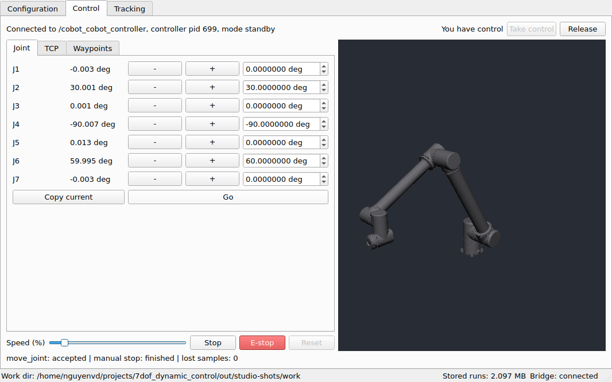
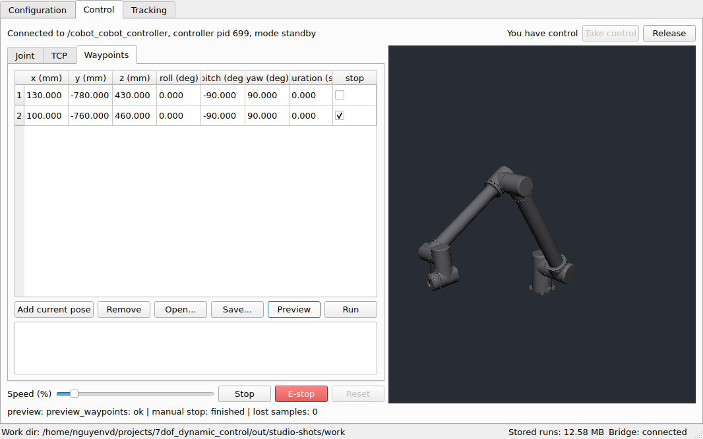
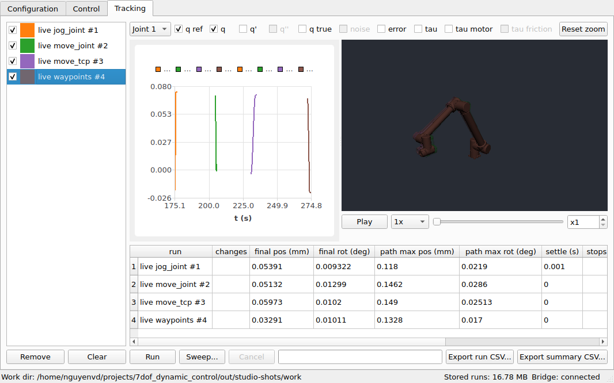

# cobot_studio

A Qt5 desktop app over `cobot_studio_core` ([ADR-021](../adr/021-cobot-studio-app.md)): a
Configuration tab (base pair, parameter overrides, controller gains, tolerances, studio file,
export for `cobot_bench`) and a Tracking tab (bench runs and sweeps on a worker thread, overlaid
charts, an error table that recomputes on tolerance edits, Run CSV and Summary CSV export). It is
off by default:

```bash
sudo apt install qtbase5-dev libqt5charts5-dev qt3d5-dev
cmake -S . -B build -DCOBOT_BUILD_STUDIO=ON && cmake --build build   # or: tools/wsl/build.sh --studio
build/src/studio/app/cobot_studio [--config-dir config] [--work-dir ~/.cache/cobot_studio/runs]
```

Under WSL the window opens through WSLg (Windows 11, no X server needed). Each run materialises
its inputs under the work dir, never in the repository. The source stays MIT; the `cobot_studio`
binary links Qt Charts (GPLv3), so the binary as distributed is under GPLv3.

## 3D view

The Tracking tab also has a 3D view (Qt3D) that replays the checked runs at the chart's time
cursor: the selected run solid, up to three other checked runs as ghosts in their colours, the
plant's true joint angles when the run has them (else the logged `q`). The selected run shows
its tip trace, the dashed desired path, the goal points, a sphere of the goal tolerance and a
red cross at the hold time. Play (0.25x, 1x, 4x) and the time slider move the same cursor as the
chart; the magnify box (x1 to x1000) scales the tip's deviation from the desired path and the
sphere together. The meshes of `src/sim/meshes` are read once, off the GUI thread. The 3D test
runs under `xvfb-run` when it is installed (`xvfb libgl1-mesa-dri`) and skips without OpenGL.

## Control tab

The Control tab (between Configuration and Tracking) drives a controller through the studio
bridge `/cobot_<name>`, chosen with `--bridge <name>` (default `cobot_controller`, the Gazebo
controller's node name). "Take control" claims authority. The joint page jogs a joint while its
`-` / `+` button is held and moves to typed-in goals (bounded by the jog band of the session's
limits); the TCP page jogs and moves the TCP in the base or tool frame; the waypoint page teaches
the current TCP pose, opens and saves waypoint files, previews them (issues per waypoint, the
planned path in the live 3D view) and runs them. Stop, E-stop and Reset stay visible below the
pages, next to a speed slider shared with the Configuration tab. The heartbeat runs on the GUI
timer on purpose: a frozen window stops the robot and gives authority back; closing the window
releases it. Every finished motion arrives in the Tracking tab as a live run ("live move_joint
#1") read from the Recorder segment the host exports (the motion plus a 1 s settle window), with
the same charts, error table and 3D replay as bench runs. "Apply to Gazebo" in the Configuration
tab materialises the configuration and applies it while the loop is in standby; the rows the
Gazebo path ignores (payload, friction, transmission, position source, timing, comm) are greyed
while connected.

```bash
# Against the bench host (no Gazebo), in two terminals:
build/src/bench/cobot_bench serve --config config/default.yaml \
  --imperfections config/imperfections/ideal.yaml --name cobot_bench
build/src/studio/app/cobot_studio --bridge cobot_bench
# Against Gazebo:
ros2 launch cobot_sim sim.launch.py controller:=cobot_controller studio:=true
build/src/studio/app/cobot_studio   # --bridge cobot_controller
```

## Manual control

1. Start a host. For Gazebo, run `ros2 launch cobot_sim sim.launch.py controller:=cobot_controller
   studio:=true [gui:=true] [imperfections_path:=<profile>] [seed:=N]` (after `sim.sh build` and
   `source tools/wsl/env.sh`). Without Gazebo, run `cobot_bench serve --config
   config/default.yaml --imperfections <profile> [--seed N]` (region `/cobot_cobot_bench`).
2. Start `cobot_studio --bridge cobot_controller` (or `--bridge cobot_bench`). The status bar
   shows "Bridge: connected".
3. In the Control tab, press **Take control**. The jog and Go buttons are enabled only while the
   studio holds authority. **Release** gives authority back, and so does closing the window.
4. The three pages:
   - **Joint**: hold `-` / `+` to jog one joint. **Copy current**, edit the goals and press
     **Go** for a joint move.
   - **TCP**: the same in the base or the tool frame. A goal pose is a `move_tcp`.
   - **Waypoints**: **Add current pose**, **Open...** / **Save...** a waypoint file,
     **Preview** (issues per waypoint, the path in the 3D view), then **Run**.
5. Below the pages:
   - **Stop** decelerates to standby.
   - **E-stop** holds at once (`estop`). **Reset** leaves the hold.
   - The speed slider (default 10 %) scales the joint and TCP limits of jogs and moves.
     Waypoint runs keep their validated durations.
6. Each finished motion appears in the Tracking tab as a live run, for example "live move_joint
   #2", with the same charts, error table and 3D replay as a bench run.
7. **Apply to Gazebo** in the Configuration tab applies the edited configuration while the loop
   is in standby. While connected, the rows the Gazebo path ignores are greyed: payload,
   friction, transmission, position source, timing and comm.





To drive a host headless (CI, scripts), use one line per session, for example:
`cobot_bridge_cli cobot_bench claim move-joint:0,30,0,-90,0,60,0 release`. On Gazebo, use `ros2
run cobot_ros2 cobot_bridge_cli cobot_controller ...`.

## Safety

From [ADR-022](../adr/022-shm-bridge-and-manual-control.md):

- Heartbeat: the studio beats every 50 ms. If no beat arrives for 200 ms (a frozen or killed
  studio), the motion stops with deceleration and authority goes back.
- Deadman: a jog not refreshed for 100 ms decelerates to zero.
- Jog band: jogs and joint moves stop at the soft margin + 2° (5° from the URDF limits by
  default), never in the holding band.
- One command source: while the studio holds authority, the RViz panel's goals and `~/reset`
  are refused ("studio is in control").

Measurements: [`docs/results/studio/`](../results/studio/README.md) (PF-02, stop
guarantee, sample live runs).
