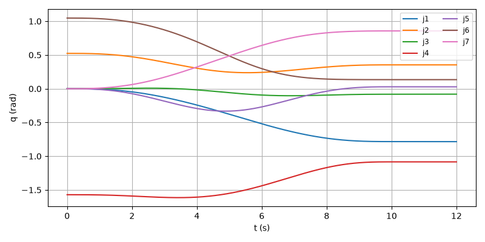
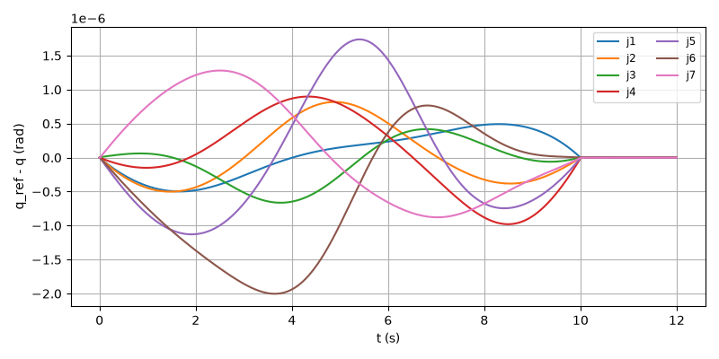
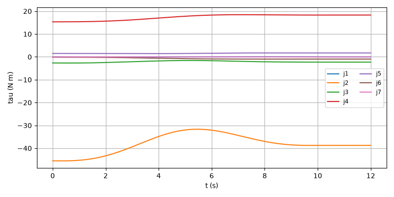
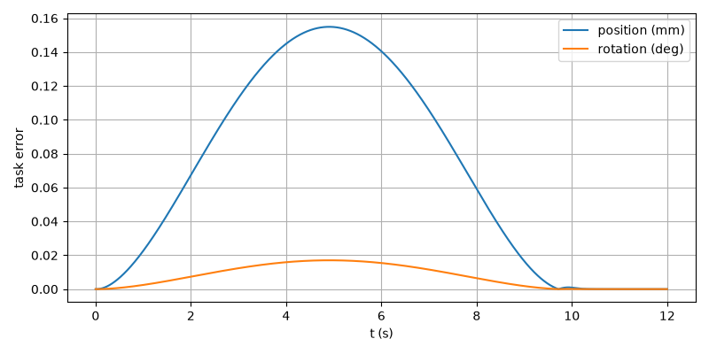

# E2E-01 report

Run: `run1.csv`, evaluated at t = 11.999 s. Result: **PASS**

| Metric | Value | Threshold | Result |
| --- | --- | --- | --- |
| final_pos_err_m | 2.64372e-10 | 0.002 | PASS |
| final_rot_err_deg | 9.81231e-09 | 1 | PASS |
| rms_joint_err_rad | 9.75773e-07 | 0.01 | PASS |
| final_rot_err_rad | 1.71257e-10 | | |
| peak_tau_ratio | 0.5233 | | |
| sat_time_s | 0 | | |
| held | no | | |

## Joint tracking RMS (tracking and finished rows)

| Joint | RMS (rad) |
| --- | --- |
| 1 | 3.02824e-07 |
| 2 | 3.94809e-07 |
| 3 | 2.95622e-07 |
| 4 | 5.30864e-07 |
| 5 | 8.23348e-07 |
| 6 | 9.75773e-07 |
| 7 | 6.88266e-07 |

## Plots

