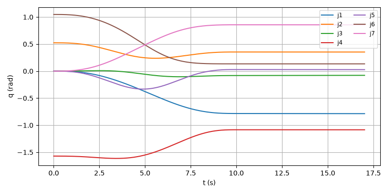
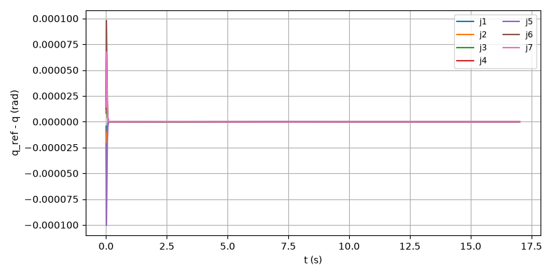
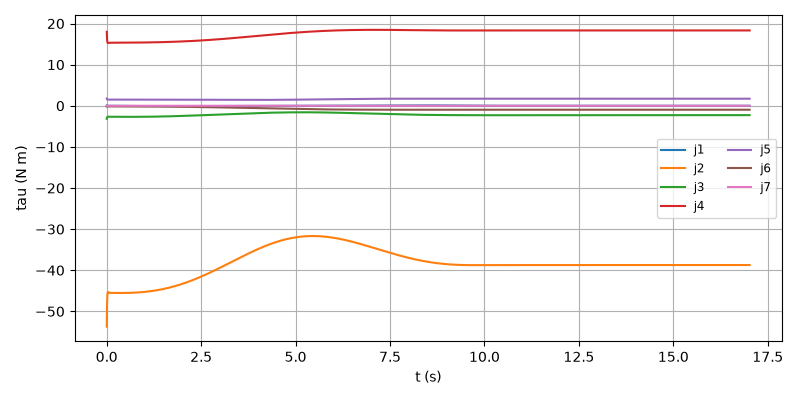
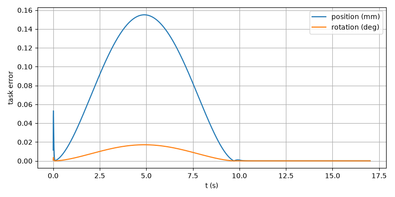

# E2E-07 report

Run: `run.csv`, evaluated at t = 17.019 s. Result: **PASS**

| Metric | Value | Threshold | Result |
| --- | --- | --- | --- |
| final_pos_err_m | 1.0052e-11 | 0.002 | PASS |
| final_rot_err_deg | 8.44742e-10 | 1 | PASS |
| rms_joint_err_rad | 3.65005e-06 | 0.01 | PASS |
| final_rot_err_rad | 1.47435e-11 | | |
| peak_tau_ratio | 0.6174 | | |
| sat_time_s | 0 | | |
| held | no | | |

## Joint tracking RMS (tracking and finished rows)

| Joint | RMS (rad) |
| --- | --- |
| 1 | 7.69148e-07 |
| 2 | 1.77399e-06 |
| 3 | 1.40801e-06 |
| 4 | 2.14555e-06 |
| 5 | 3.65005e-06 |
| 6 | 3.55679e-06 |
| 7 | 2.46076e-06 |

## Plots

