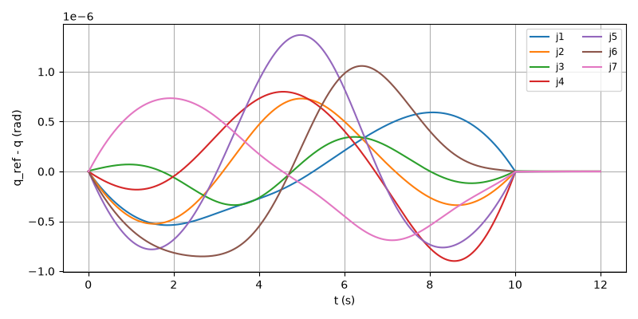
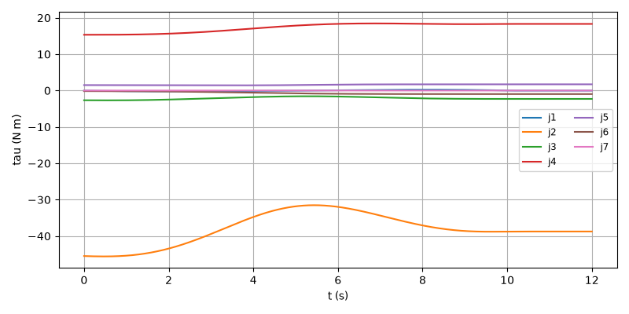
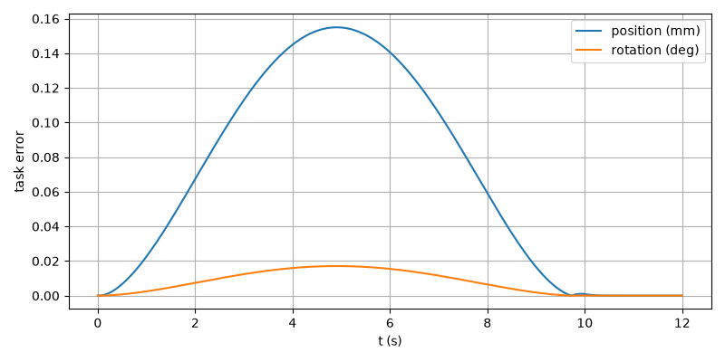

# E2E-01 report

Run: `run1.csv`, evaluated at t = 11.999 s. Result: **PASS**

| Metric | Value | Threshold | Result |
| --- | --- | --- | --- |
| final_pos_err_m | 6.65047e-11 | 0.002 | PASS |
| final_rot_err_deg | 8.68204e-09 | 1 | PASS |
| rms_joint_err_rad | 6.65731e-07 | 0.01 | PASS |
| final_rot_err_rad | 1.5153e-10 | | |
| peak_tau_ratio | 0.524 | | |
| sat_time_s | 0 | | |
| held | no | | |

## Joint tracking RMS (tracking and finished rows)

| Joint | RMS (rad) |
| --- | --- |
| 1 | 3.60897e-07 |
| 2 | 3.68312e-07 |
| 3 | 1.74993e-07 |
| 4 | 4.76887e-07 |
| 5 | 6.65731e-07 |
| 6 | 5.81683e-07 |
| 7 | 4.33201e-07 |

## Plots

