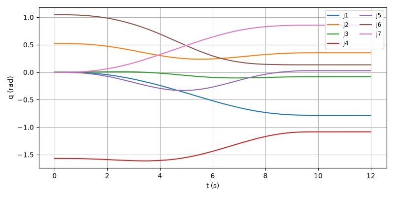
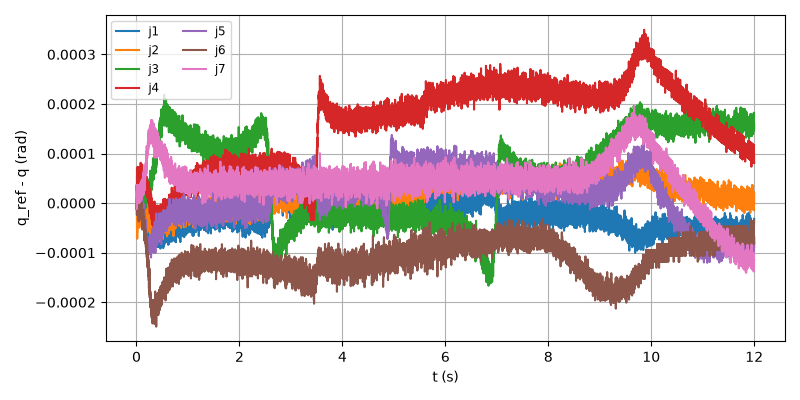
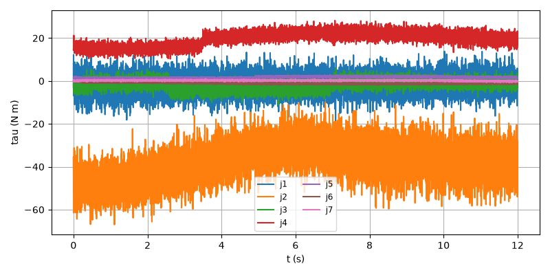
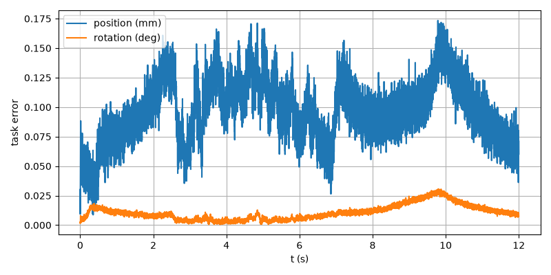

# E2E-02 report

Run: `run1.csv`, evaluated at t = 11.998 s. Result: **PASS**

| Metric | Value | Threshold | Result |
| --- | --- | --- | --- |
| final_pos_err_m | 6.00875e-05 | 0.005 | PASS |
| final_rot_err_deg | 0.00745138 | 2 | PASS |
| rms_joint_err_rad | 0.000181395 | 0.02 | PASS |
| final_rot_err_rad | 0.000130051 | | |
| peak_tau_ratio | 0.7699 | | |
| sat_time_s | 0 | | |
| held | no | | |

## Joint tracking RMS (tracking and finished rows)

| Joint | RMS (rad) |
| --- | --- |
| 1 | 3.60974e-05 |
| 2 | 3.70494e-05 |
| 3 | 0.000105329 |
| 4 | 0.000181395 |
| 5 | 5.4999e-05 |
| 6 | 0.000115945 |
| 7 | 6.62246e-05 |

## Plots

