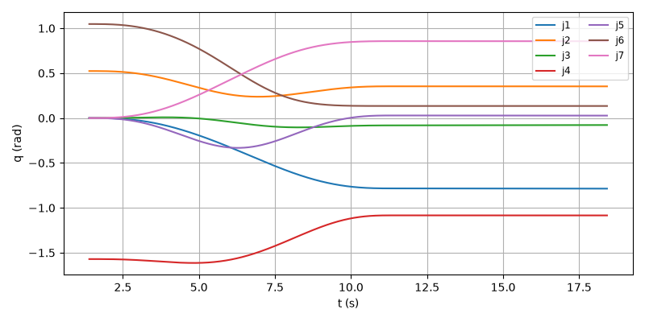
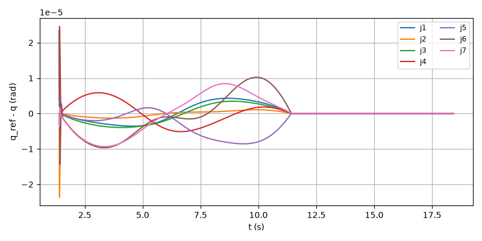
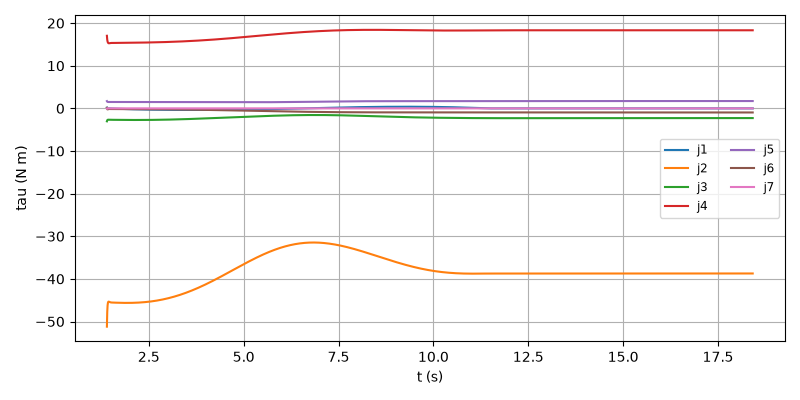
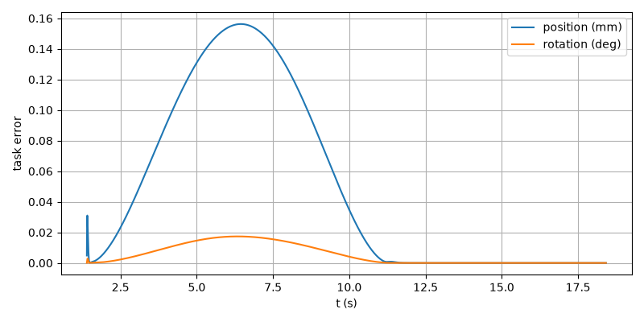

# E2E-07 report

Run: `run.csv`, evaluated at t = 18.415 s. Result: **PASS**

| Metric | Value | Threshold | Result |
| --- | --- | --- | --- |
| final_pos_err_m | 4.20518e-11 | 0.002 | PASS |
| final_rot_err_deg | 1.7529e-08 | 1 | PASS |
| rms_joint_err_rad | 4.79305e-06 | 0.01 | PASS |
| final_rot_err_rad | 3.05938e-10 | | |
| peak_tau_ratio | 0.5885 | | |
| sat_time_s | 0 | | |
| held | no | | |

## Joint tracking RMS (tracking and finished rows)

| Joint | RMS (rad) |
| --- | --- |
| 1 | 2.20233e-06 |
| 2 | 1.10112e-06 |
| 3 | 2.09024e-06 |
| 4 | 2.823e-06 |
| 5 | 3.68187e-06 |
| 6 | 4.79305e-06 |
| 7 | 4.54483e-06 |

## Plots

