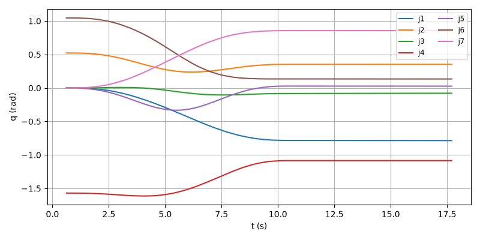
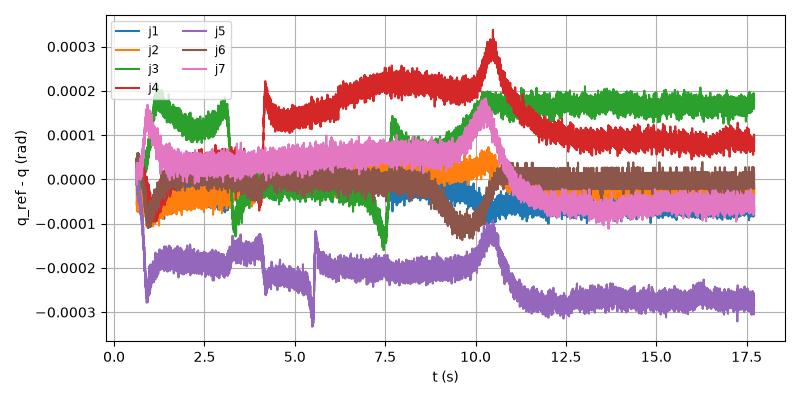
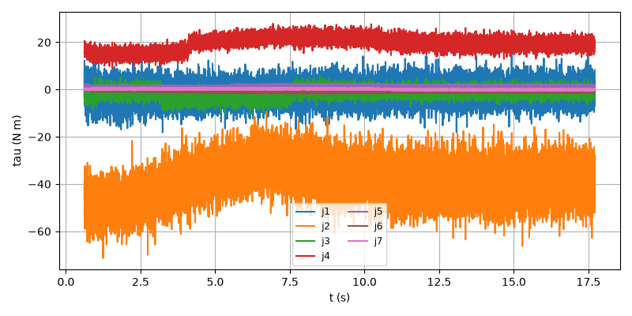
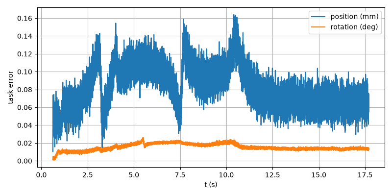

# E2E-09 report

Run: `run.csv`, evaluated at t = 17.707 s. Result: **PASS**

| Metric | Value | Threshold | Result |
| --- | --- | --- | --- |
| final_pos_err_m | 7.08383e-05 | 0.005 | PASS |
| final_rot_err_deg | 0.0138928 | 2 | PASS |
| rms_joint_err_rad | 0.000229359 | 0.02 | PASS |
| final_rot_err_rad | 0.000242475 | | |
| peak_tau_ratio | 0.8196 | | |
| sat_time_s | 0 | | |
| held | no | | |

## Joint tracking RMS (tracking and finished rows)

| Joint | RMS (rad) |
| --- | --- |
| 1 | 4.66283e-05 |
| 2 | 2.92505e-05 |
| 3 | 0.000128925 |
| 4 | 0.000141682 |
| 5 | 0.000229359 |
| 6 | 3.02022e-05 |
| 7 | 6.1027e-05 |

## Plots

