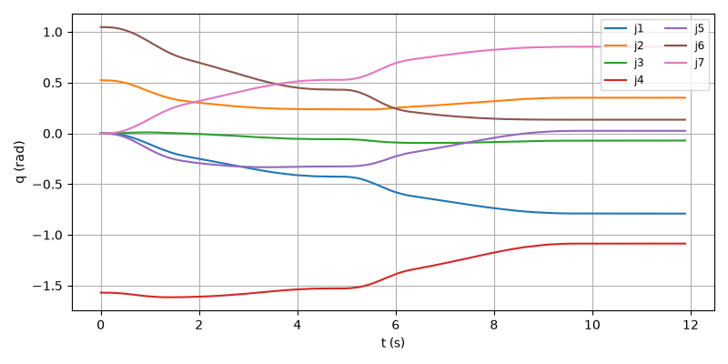
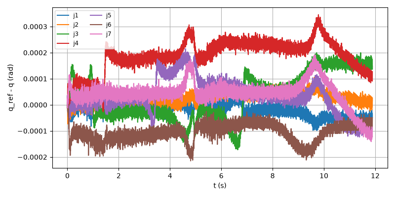
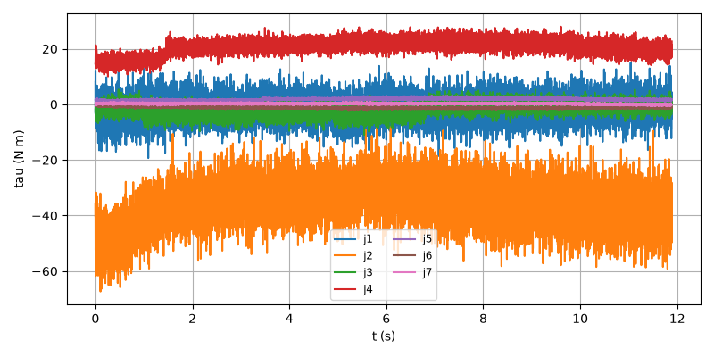
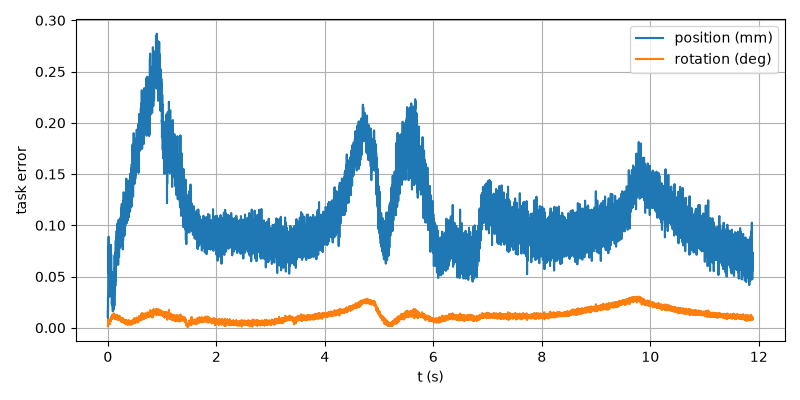

# E2E-10 report

Run: `run1.csv`, evaluated at t = 11.888 s. Result: **PASS**

| Metric | Value | Threshold | Result |
| --- | --- | --- | --- |
| final_pos_err_m | 6.7474e-05 | 0.005 | PASS |
| final_rot_err_deg | 0.00946968 | 2 | PASS |
| rms_joint_err_rad | 0.000200505 | 0.02 | PASS |
| stop_pos_err_m | 0.000109976 | 0.005 | PASS |
| final_rot_err_rad | 0.000165277 | | |
| peak_tau_ratio | 0.7741 | | |
| sat_time_s | 0 | | |
| held | no | | |

## Joint tracking RMS (tracking and finished rows)

| Joint | RMS (rad) |
| --- | --- |
| 1 | 2.48294e-05 |
| 2 | 3.79871e-05 |
| 3 | 7.59902e-05 |
| 4 | 0.000200505 |
| 5 | 7.33924e-05 |
| 6 | 0.000115977 |
| 7 | 6.39105e-05 |

## Plots

