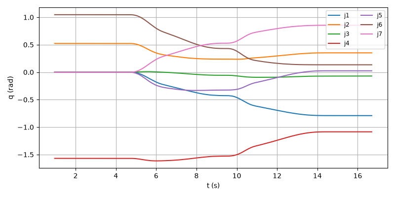
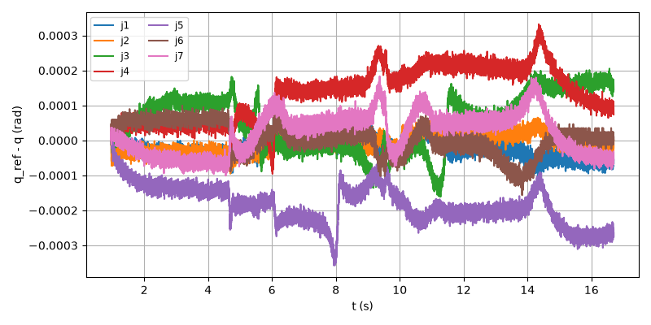
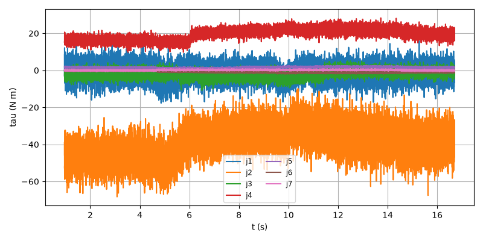
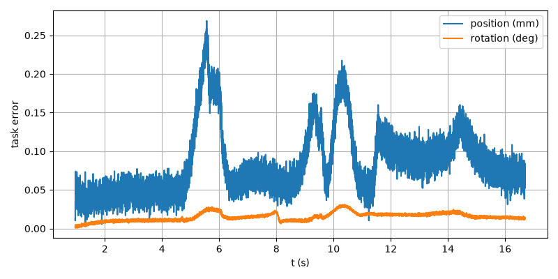

# E2E-11 report

Run: `run.csv`, evaluated at t = 16.696 s. Result: **PASS**

| Metric | Value | Threshold | Result |
| --- | --- | --- | --- |
| final_pos_err_m | 5.48532e-05 | 0.005 | PASS |
| final_rot_err_deg | 0.0132239 | 2 | PASS |
| rms_joint_err_rad | 0.000196225 | 0.02 | PASS |
| final_rot_err_rad | 0.000230801 | | |
| peak_tau_ratio | 0.7851 | | |
| sat_time_s | 0 | | |
| held | no | | |

## Joint tracking RMS (tracking and finished rows)

| Joint | RMS (rad) |
| --- | --- |
| 1 | 2.71766e-05 |
| 2 | 2.50186e-05 |
| 3 | 7.51086e-05 |
| 4 | 0.000179554 |
| 5 | 0.000196225 |
| 6 | 4.10453e-05 |
| 7 | 6.95239e-05 |

## Plots

